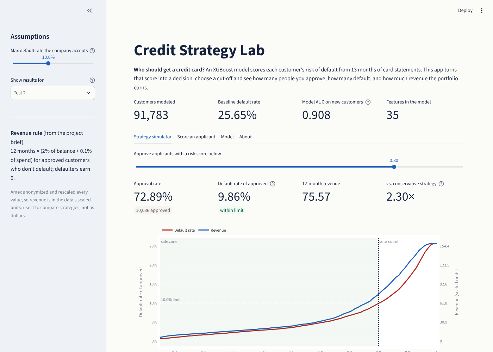

# Credit Strategy Lab

**From a default prediction to an approval decision.** An XGBoost model scores credit card customers' risk from 13 months of statements; an interactive app turns that score into a cut-off strategy and shows its trade-offs: approval rate, default rate, revenue, expected loss and profit.

> Built on the [American Express Default Prediction](https://www.kaggle.com/competitions/amex-default-prediction) dataset.

**Live app:** https://credit-strategy-lab.streamlit.app/

## Why this project

Most default models stop at the AUC. A lender still has to answer: **where do we draw the line?** This project follows the model all the way to that decision:

- Approve more applicants and revenue grows, but so do defaults.
- The company caps the default rate at 10%, checked on training and two hold-out samples.
- The app finds the highest cut-off that stays under the limit on every sample, and shows what it costs to go one step further.

## Results

| | Value |
|---|---|
| Customers modeled | 91,783 (random 20% sample) |
| Baseline default rate | 25.65% |
| Final model | XGBoost, 50 trees, 35 features |
| AUC (Train / Test 1 / Test 2) | 0.928 / 0.912 / 0.908 |
| Neural network AUC (Test 2), for comparison | 0.906 |

| Strategy (Test 2) | Cut-off | Approved | Default rate | Revenue* |
|---|---|---|---|---|
| Conservative | 0.61 | 61.7% | 4.89% | 32.89 |
| Aggressive | 0.80 | 72.9% | 9.86% | 75.57 |

\*Amex anonymized and rescaled all values, so revenue is in the data's scaled units: it compares strategies but is not dollars.

## The app



| Tab | What you can do |
|---|---|
| **Strategy simulator** | Move the cut-off and the default-rate limit; see approval rate, default rate and revenue on Train, Test 1 or Test 2, and the highest safe cut-off. |
| **Score an applicant** | Start from a typical customer, move the top risk drivers, and watch the score and its SHAP explanation change. |
| **Model** | Rank ordering on three samples, XGBoost vs. neural network, SHAP drivers, and how 72 XGBoost and 32 neural-network models were compared. |

Run it locally:

```bash
pip install -r requirements.txt
streamlit run app.py
```

## Pipeline

1. **Sampling:** a random 20% of customers and 10% of the 188 statement features, read in chunks from the 16 GB file.
2. **Encoding:** one-hot encoding for categorical features, missing values kept as their own level.
3. **Feature engineering:** 339 account-level features from up to 13 monthly statements (averages, min/max, sums over 3 to 12 months, % change, latest value, response rates).
4. **Feature selection:** two XGBoost models; features above 0.5% importance in either → 35.
5. **Model selection:** grid search of 72 XGBoost and 32 neural-network models; keep models whose Train and Test 2 AUC are within 0.02, then take the best average AUC.
6. **Explainability:** SHAP (overall drivers and per-customer explanations).
7. **Strategy:** cut-offs that keep the default rate under the limit on all three samples.

Full code: [`notebooks/credit_risk_model.ipynb`](notebooks/credit_risk_model.ipynb) (runs in Google Colab).

## Power BI dashboard

A Power BI report built on the same summary tables from the app. It has a line chart of approval rate and default rate across cut-offs, a threshold slicer, three KPI cards (average approval rate, average revenue and average default rate at the chosen cut-off) and a column chart of default rate by risk bin (1 is the safest, 10 the riskiest), all for the Test 2 sample. The cut-off data comes from `app_data/threshold_grid.csv`. Open `powerbi/credit-strategy-dashboard.pbix` in Power BI Desktop (Windows). `approval_rate` is a calculated column, `n_accepted / n_total`, added in Power Query. The risk-bin table is entered directly in the report.

## Data note

The competition data can't be redistributed (and the raw file is 16 GB), so this repository contains **no customer-level data**: only the trained model and summary tables in `app_data/`, all produced by the notebook. To rebuild everything, download the data from Kaggle and run the notebook.

## Limitations and next steps

- **Revenue isn't profit:** defaulters earn 0, but what they don't repay isn't subtracted. Next step: add expected loss and choose the cut-off by profit.
- **Scaled data:** amounts compare strategies but can't be converted to dollars.
- **No out-of-time test:** the hold-out samples come from the same period and also guided model choices; validating on a later period is the next check.
- **Feature sampling:** only 10% of features were used, so Payment features were left out by chance.

## Tech

Python · pandas · XGBoost · TensorFlow/Keras · SHAP · scikit-learn · Streamlit · Plotly
